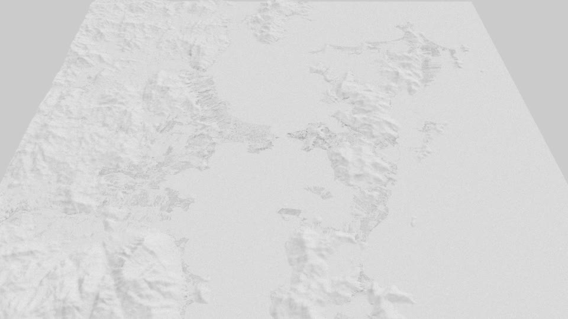
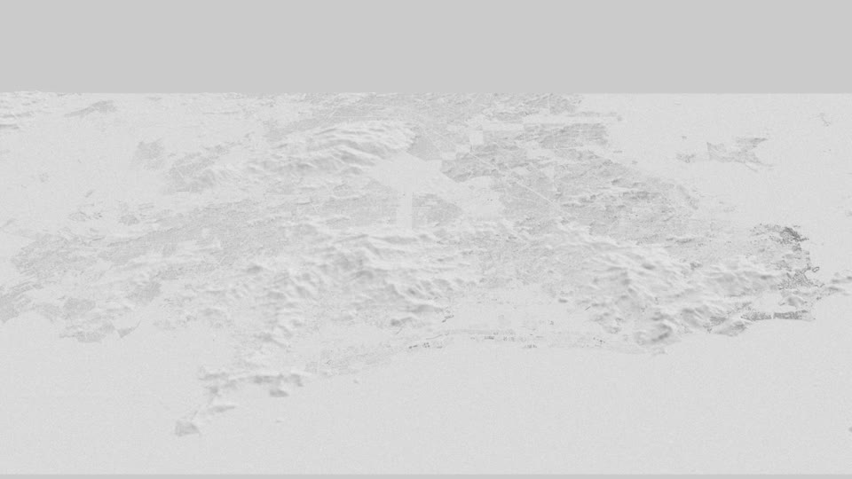

# Render 3D na GPU: Blender × alternativas (24/10/2026)

Pergunta do Nei: quanto custaria fazer o timelapse em Blender, e qual alternativa usa a GPU da nossa máquina.

**Resposta curta:** o Blender que temos não usa a GPU, então cada vídeo levaria de 4 a 6 dias de render. O **Mitsuba 3** roda na GPU (NVIDIA GB10) e, medido com os prédios e o relevo de cada cidade, faria um vídeo inteiro em **1 a 5 horas**. Para comparar: o motor atual (deck.gl no Chrome) faz o mesmo vídeo em **5 a 18 minutos**, medido nos logs de render.

## O que é cada coisa

- **Motor atual (deck.gl):** é como os vídeos são feitos hoje, e **não é o Remotion**. É uma página web (`motor/mapa.html`) que desenha o mapa 3D com a biblioteca deck.gl. O script `motor/render.mjs` abre essa página num Chrome sem janela, usando a GPU pelo Vulkan, e fotografa quadro por quadro; o `render_trechos.sh` faz isso em trechos de 60 s e junta tudo com o ffmpeg. Desenha como um jogo (rasterização): muito rápido, mas com luz e sombra simplificadas, daí o visual de "mapa".
- **Mitsuba 3:** programa de render de código aberto, criado por pesquisadores da EPFL (Suíça). Calcula a luz como na vida real (*path tracing*): segue milhões de raios de luz quicando na cena, e daí saem sombras macias, luz rebatida entre prédios e céu realista. É o mesmo princípio do Cycles do Blender, o visual de "maquete fotografada". Não tem tela nem editor como o Blender: a cena é toda montada por um script Python, o que combina com o nosso jeito de trabalhar, porque o motor já é todo por script. Roda na GPU NVIDIA pelo OptiX. Instala com `pip install mitsuba`.
- **Blender:** programa completo de 3D, com editor visual. Aqui só roda pelo processador (ver seção 2).

## 1. A máquina

| Item | Valor |
|---|---|
| GPU | NVIDIA GB10 (DGX Spark), driver 580.95.05, CUDA 13.0, OptiX presente (`libnvoptix`) |
| CPU | ARM64 (aarch64), 20 núcleos, 119 GB de memória (compartilhada com a GPU) |
| Blender | 4.0.2 do apt |

## 2. Por que o Blender fica lento aqui

- **Cycles:** o pacote do apt não traz o código da GPU do GB10 (sm_121) nem o removedor de ruído. Roda só no processador.
- **EEVEE:** o teste de antes (`~/projetos/reel3d-blender/out/medir.log`) rodou no `DISPLAY=:99`, um X virtual (Xvfb) **sem GPU**. Os 40 s por quadro foram de render por software. Conferido de novo em 24/10: o mesmo resultado no `:99` e no `:10` (xrdp).
- **Não há Blender oficial para Linux ARM64.** Para usar a GPU seria preciso compilar do código-fonte com CUDA/OptiX (um relato no Jetson Orin levou ~3 dias de erros de compilação) ou abrir um X com o driver NVIDIA para o EEVEE.

Medido num quarto de 8 m² (cena simples), por quadro: EEVEE por software ~40 s, Cycles no processador 57–83 s. Uma cidade é mais pesada, então esses números são o piso.

## 3. Alternativas pesquisadas

| Opção | Usa a GPU aqui? | Esforço | Observação |
|---|---|---|---|
| **Mitsuba 3** (Python, path tracing com OptiX) | **Sim, medido** | Médio | Instala com `pip` (pacote aarch64 3.9.1). Tem removedor de ruído OptiX. |
| three.js + three-gpu-pathtracer, no mesmo Chrome do motor | Provável: o Chrome já usa Vulkan na GPU | Baixo/médio | Não testado. Aproveita a parte web do motor atual. |
| Blender compilado com CUDA/OptiX | Possível | Alto | Risco de quebrar com o CUDA 13. |
| EEVEE com X do driver NVIDIA | Possível | Baixo, mas pode exigir root | Teste rápido pendente. |
| NVIDIA Isaac Sim / Omniverse (RTX) | Sim, suporte oficial no DGX Spark | Alto | Instalação pesada. Exagero para o caso. |
| Unreal Engine 5 | Não: sem editor ARM64 oficial, travamentos relatados | — | Descartado. |
| Godot 4 | Talvez: precisa compilar para ARM64 | Médio/alto | Não ganha das opções acima. |

## 4. Medida do Mitsuba com os dados reais das cidades

**Script:** `scripts/bench_mitsuba.py <cidade> [spp]`.

**Montagem da cena:**
- Cada prédio do `predios_meta.npz` vira uma caixa: lado igual à raiz da área, altura igual a `alt`, apoiada no relevo.
- O relevo é a malha do `chao.npy`, na mesma resolução do motor.

**Condições do render:**
- Câmera oblíqua vendo o recorte inteiro, que é o pior caso: tudo na tela.
- 1920×1080, 64 amostras por pixel, até 4 rebatidas de luz, sol mais céu.

**O que foi medido:**
- `quadro` = tempo de render de um quadro.
- `atualiza` = tempo para mudar a altura de todos os prédios e refazer a estrutura de raios. É o que acontece a cada quadro do timelapse, em que os prédios nascem e crescem.

| Cidade | Prédios | Relevo (pontos) | Altitude máx. | Recorte | Triângulos | Vídeo | Quadros (30 fps) | **Motor atual (deck.gl), medido** | Mitsuba por quadro (render + atualiza) | Mitsuba, cena simples | **Mitsuba, ×4 (visual final)** | Blender EEVEE por software (~40 s) |
|---|---|---|---|---|---|---|---|---|---|---|---|---|
| Floripa | 356.526 | 1692×2124 | 1263 m | 46×65 km | 10,7 M | 6,3 min | 11.274 | **0,08 s/quadro · ~17 min** | 0,15 + 0,08 s | 0,7 h | **~3 h** | ~125 h |
| Rio | 1.818.599 | 2808×1368 | 980 m | 80×42 km | 25,9 M | 7,0 min | 12.549 | **0,08 s/quadro · ~18 min** | 0,16 + 0,21 s | 1,3 h | **~5 h** | ~139 h |
| Itaguaí | 801.802 | 2700×1980 | 1635 m | 77×61 km | 18,7 M | 6,1 min | 10.992 | **0,07 s/quadro · ~15 min** | 0,16 + 0,15 s | 0,9 h | **~4 h** | ~122 h |
| Itaguaí centro | 21.781 | 180×162 | 43 m | 5×5 km | 0,3 M | 5,3 min | 9.630 | **0,07 s/quadro · ~12 min** | 0,21 + 0,02 s | 0,6 h | **~2 h** | ~107 h |
| Porto Alegre | 533.407 | 1476×1440 | 305 m | 39×44 km | 9,6 M | 1,6 min | 2.850 | **0,10 s/quadro · ~5 min** | 0,14 + 0,07 s | 0,2 h | **~1 h** | ~32 h |
| Capitais: Salvador | 389.344 | 1800×1368 | 179 m | 54×42 km | 8,8 M | 4,4 min | 7.941 | **0,07 s/quadro · ~11 min** | 0,12 + 0,06 s | 0,4 h | **~2 h** | ~88 h |
| Capitais: Rio | 1.818.599 | 2808×1368 | 980 m | 80×42 km | 25,9 M | 4,1 min | 7.368 | **0,08 s/quadro · ~11 min** | 0,16 + 0,21 s | 0,8 h | **~3 h** | ~82 h |
| Capitais: Brasília | 837.811 | 1872×1440 | 1342 m | 56×44 km | 13,8 M | 4,3 min | 7.826 | **0,08 s/quadro · ~11 min** | 0,14 + 0,11 s | 0,5 h | **~2 h** | ~87 h |

 

O Capitais inteiro (12,7 min) levou **~33 min** no motor atual. No Mitsuba daria **~7 h**; no Blender por software, **~10 dias**.

Os tempos do motor atual saem dos logs `cidades/<id>/final/trechos/t*.log` (renders de 21–23/10). O tempo total soma a abertura do Chrome a cada trecho de 60 s. Mesmo com a cena simples, o Mitsuba é ~3× mais lento por quadro que o deck.gl. Com o visual final, a diferença deve ficar perto de 12×.

**De onde vêm os números:**
- `atualiza` foi medido em Floripa (0,08 s) e no Rio (0,21 s). Nas outras cidades está estimado pelo número de triângulos.
- Na mesma medida, Floripa com 16 amostras levou 0,06 s por quadro.
- A GPU consumiu ~33 W durante o teste.

### O que a medida ainda não cobre (por isso o ×4)

- **Material:** a cena medida é branca e lisa. O vídeo real tem textura de satélite no chão, água e cores por época.
- **Câmera de perto (zoom ≥ 18):** o Itaguaí centro, com a cidade enchendo a tela, já foi o mais lento por quadro (0,21 s).
- **Removedor de ruído** OptiX e gravação do PNG.
- **Peças do motor atual a refazer:** globo, ruas, marcos 3D, frotas e pontes. Os cartões, o contador e o HUD podem continuar em HTML por cima.

O ×4 é margem, não medida. O próximo passo é medir um trecho real com textura e câmera de perto.

## 5. Conclusão

- **Com o Mitsuba, o render sai em horas, não dias.** Ainda assim é mais lento que o motor atual (minutos). Uma revisão por noite é viável, mas acaba o "corrige e vê de novo em 15 min" de hoje.
- **O maior custo passa a ser refazer o motor.** É levar para o Mitsuba o que hoje o `mapa.html` faz no deck.gl: globo, câmera por bloco, prédios por ano, ruas, marcos. Conta em semanas de sessão.
- **Caminho barato para testar o visual:**
  1. Renderizar 1 bloco de Floripa (10–20 s) no Mitsuba, com textura de satélite e câmera do `roteiro.json`.
  2. Comparar com o mesmo bloco do motor atual.
  3. Em paralelo, testar o three-gpu-pathtracer no Chrome, que muda menos o motor.

## Como reproduzir

```bash
python3 -m venv <pasta>/mi && <pasta>/mi/bin/pip install mitsuba drjit numpy
<pasta>/mi/bin/python scripts/bench_mitsuba.py floripa 64   # imprime JSON com tempos e salva PNG
```

Armadilha: o alcance padrão da câmera do Mitsuba é 10 km (`far_clip`). Com o recorte de uma cidade a imagem sai só com o céu, por isso o script usa `far_clip: 1e6`.

## Fontes

- [Isaac Sim — requisitos (DGX Spark aarch64)](https://docs.isaacsim.omniverse.nvidia.com/latest/installation/requirements.html)
- [Blender devtalk — build ARM64 Linux com CUDA/OptiX no Orin](https://devtalk.blender.org/t/linux-aarch64-source-build/35311)
- [Blender devtalk — compilar para Linux arm64](https://devtalk.blender.org/t/is-it-possible-to-compile-blender-for-linux-arm64/30125)
- [BlenderKit — Blender em ARM64 Linux](https://www.blenderkit.com/articles/blenderkit-on-arm64-linux/)
- [Mitsuba 3 no PyPI](https://pypi.org/project/mitsuba)
- [three-gpu-pathtracer](https://github.com/gkjohnson/three-gpu-pathtracer)
- [Unreal — pedido de editor ARM64 para DGX Spark](https://forums.unrealengine.com/t/feature-request-official-unreal-editor-linux-arm64-aarch64-support-for-nvidia-dgx-spark-gb10/2731250)
- [NVIDIA forum — build Unreal para DGX Spark falhando](https://forums.developer.nvidia.com/t/unreal-build-for-gdx-spark-failing/361004)
- [Godot — exportar para Linux](https://docs.godotengine.org/en/4.6/tutorials/export/exporting_for_linux.html)
